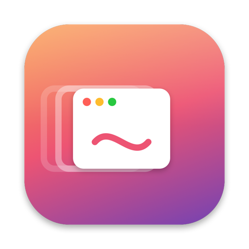

<p align="center"></p>

<h1 align="center">Veda</h1>
<p align="center">Close the last window, and the app goes with it.</p>
<p align="center"><a href="https://github.com/AlparslanSemiz/Veda/actions/workflows/build.yml"></a> <a href="https://github.com/AlparslanSemiz/Veda/releases/latest"></a></p>

Veda (Turkish for "farewell") is a small menu bar app for macOS. When you close an app's last window, Veda quits the app, the way Windows and GNOME do.

Swift Quit and Last Window Quits stopped working on macOS 26, because the Accessibility notifications they wait for no longer arrive. Veda doesn't wait for notifications. It checks windows about eight times a second, so an app quits roughly 0.3 seconds after its last window closes.

## Install

With Homebrew:

```sh
brew install alparslansemiz/tap/veda
brew services start veda
```

Or with one line, without Homebrew:

```sh
curl -fsSL https://raw.githubusercontent.com/AlparslanSemiz/Veda/main/install.sh | zsh
```

Both build Veda from source on your Mac, so they need Apple's Command Line Tools. Homebrew keeps the app in its own folder and `brew services` starts it at login; the one-line script installs it to `~/Applications` and sets up the login item itself. Then turn on **Veda** under System Settings → Privacy & Security → **Accessibility**.

## What it gets right

- **Only real closes count.** Minimizing a window, hiding an app with ⌘H or moving a window to another Space never quits anything.
- **Browsers across Spaces.** Chromium browsers report windows on other Spaces as on screen. Veda checks which Space a window belongs to instead.
- **Menu bar controls.** Pause Veda, reopen recently quit apps with one click, or exclude the app in front.
- **Exclusions.** One bundle id per line in `~/.config/veda/blacklist.txt`. Finder and Discord are always excluded.
- **Log.** Every quit is written to `~/Library/Logs/veda.log`.

## Keep the permission across rebuilds

Run `./scripts/make_signing_cert.sh` once. It creates a local code-signing certificate, and `build.sh` signs Veda with it from then on. Without it the app is signed ad hoc and macOS asks for Accessibility again after every rebuild.

## Uninstall

```sh
launchctl bootout gui/$(id -u)/local.$(whoami).veda
rm -rf ~/Applications/Veda.app ~/Library/LaunchAgents/local.$(whoami).veda.plist ~/.config/veda ~/.local/src/Veda
```

## Requirements

macOS 14 or later and the Xcode Command Line Tools (`xcode-select --install`).

## License

MIT
